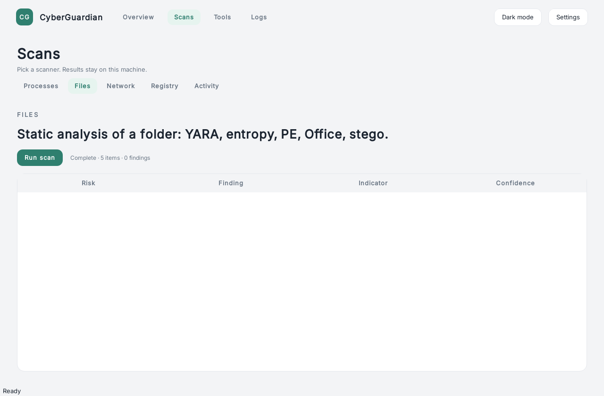
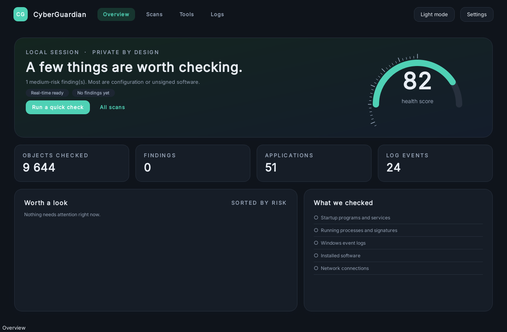
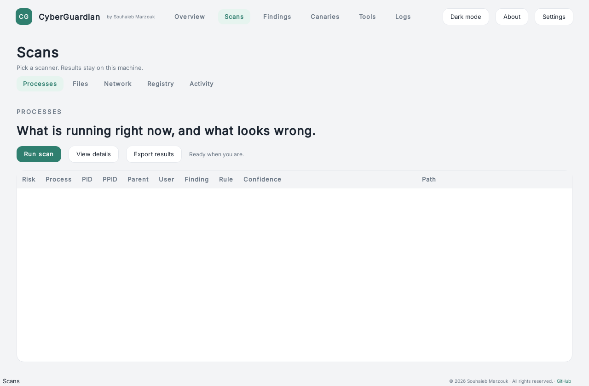
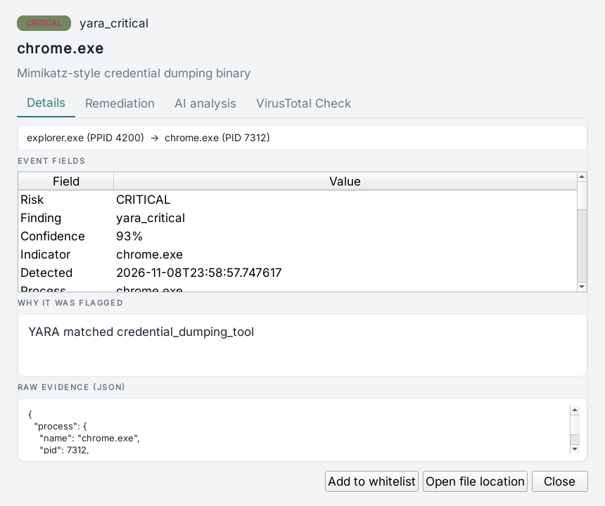

# CyberGuardian

<div align="center">


**Windows malware detection, threat hunting and incident triage — local-first.**

[](CHANGELOG.md)
[](https://www.python.org/)
[](https://www.microsoft.com/windows)
[](LICENSE)
[](tests/)
[](#languages)

**Designed & architected by [Souhaieb Marzouk](https://github.com/Souhaieb-Marzouk)**

</div>

---

CyberGuardian is a defensive security workstation for Windows: it inspects what is
running, what starts with the machine, what the registry persists, what the network
is talking to and what happened in the event log — then helps you decide what is
real, what to do about it and how to prove it afterwards.

It is built for analysts who want a transparent tool: every finding keeps its
evidence, every YARA rule is readable, every scan can be stopped and exported, and
nothing leaves the machine unless you explicitly start an AI analysis or a
VirusTotal lookup.

## Screenshots

| Overview (light) | Overview (dark) |
|---|---|
|  |  |

| Scans | Finding triage |
|---|---|
|  |  |

More: [canaries](docs/screenshots/canaries-light.png) · [About](docs/screenshots/about-dark.png)

## What's new in 1.5.0

- **Studio interface** — light and dark themes, seven pages, bundled Inter,
  remembered window geometry and scan-safe navigation.
- **English / Français** — the whole UI, dialogs, canary guidance, VirusTotal
  labels and **AI reports** switch language from Settings.
- **Findings you can triage** — process name, PID, PPID, parent, user, path,
  command line, rule and confidence in the table; event fields, process tree
  and full evidence in the detail dialog.
- **VirusTotal Check tab** — hashes, URLs, domains and public IPs, verdict table,
  and the results are automatically used by the AI analysis.
- **Persistent triage** — AI and VirusTotal results survive closing the dialog
  and export as standalone HTML reports.
- **Ransomware canaries** — realistic decoy documents in attacker-targeted
  folders, one-shot alerts and a full incident report with response guidance.
- **Working Stop button**, faster scans (signature-first, YARA budget,
  VirusTotal opt-in) and a quieter YARA engine (precision rules, no self-detection).

Full history: [CHANGELOG.md](CHANGELOG.md) · [release notes](docs/releases/).

## Features

### Detection

| Scanner | What it inspects |
|---|---|
| **Processes** | Running processes, command lines, parent/child lineage, signatures, hashes, YARA matches, behavioural heuristics, optional memory analysis |
| **Files** | YARA, entropy, PE structure, Office macros, embedded executables, steganography, signatures, hashes |
| **Network** | Live TCP/UDP connections, listeners, remote endpoints, C2-style patterns, suspicious ports |
| **Registry** | Run/RunOnce keys, services, scheduled tasks, Winlogon, persistence locations, encoded payloads |
| **Activity** | Security, System, PowerShell, Task Scheduler and Defender channels with curated rules and brute-force correlation |

Every detection carries structured evidence: process tree, file metadata, network
five-tuple, registry hive/key/value, or event identity.

### Triage and response

- **Findings page** — every detection from every scan, filterable by risk.
- **Detail dialog** — event fields, process-tree banner, why it fired, remediation
  steps, raw JSON evidence.
- **AI analysis** — verdict, confidence, risk score, technical analysis, MITRE
  ATT&CK and a four-stage playbook (verify → contain → remove → confirm).
- **VirusTotal** — engine ratios and threat names for the IoCs in the finding.
- **Exports** — CSV/JSON for scans, standalone HTML for AI and VirusTotal reports.

### System hygiene

- **Startup impact** — Run keys, Startup folders, services and scheduled tasks
  with explainable impact and reversible enable/disable.
- **Software inventory and updates** — winget-powered latest versions, advisory
  feed, guarded per-application updates.
- **Reputation checks** — file and URL verdicts with signature, location and
  optional VirusTotal evidence.
- **Quarantine** — DPAPI-encrypted vault with SHA-256 verification and safe restore.
- **Ransomware canaries** — realistic decoys with tamper detection and a full
  incident report.

<a id="languages"></a>
### Languages

English and French. Choose **Settings → Language / Langue**; the choice applies to
the interface, dialogs, canary guidance, VirusTotal summaries and the AI prompt
(the model is instructed to write the entire report in French).

## Requirements

- Windows 10 or Windows 11 (x64)
- Python 3.9+ for source installs (Python 3.12 recommended; 3.14 is not supported
  because `yara-python` wheels are not published for it)
- Administrator rights recommended for complete process, registry and event-log
  coverage
- Internet access is optional; it is only used for AI analysis and VirusTotal

## Install

### Portable executable (recommended)

1. Download `CyberGuardian.exe` (or the `.zip`) from
   [Releases](https://github.com/Souhaieb-Marzouk/CyberGuardian/releases).
2. Verify the SHA-256 published with the release:
   ```powershell
   certutil -hashfile CyberGuardian.exe SHA256
   ```
3. Run it. The executable is unsigned, so SmartScreen may ask for confirmation.
   Administrator rights are requested for full coverage.

No Python installation is required.

### From source

```powershell
git clone https://github.com/Souhaieb-Marzouk/CyberGuardian.git
cd CyberGuardian
python -m venv .venv
.\.venv\Scripts\Activate.ps1
pip install -r requirements.txt
python main.py
```

> `main_studio.py` is kept as a convenience alias for the Studio interface.

## Quick start

1. **Overview** — press **Run a quick check** for a process scan, or open **Scans**.
2. Pick a scanner and press **Run scan**. You can stop it at any time.
3. Open **Findings**, double-click a row to triage it.
4. In the dialog, use the tabs:
   - **Details** — evidence, event fields and process lineage.
   - **Remediation** — recorded response steps.
   - **AI analysis** — run the model on the finding, then export the report.
   - **VirusTotal Check** — verify hashes, IPs, domains and URLs.
5. Export results per scan or all findings from the Findings page.
6. Use **Tools** for startup, software updates, reputation checks, canaries and
   quarantine.

## Configuration

Settings are stored under the application data directory (see
[docs/ARCHITECTURE.md](docs/ARCHITECTURE.md#storage)). API keys are kept in the
Windows DPAPI-protected store, not in plain text.

| Setting | Where | Notes |
|---|---|---|
| Theme | Settings → Appearance | Light / Dark |
| Language | Settings → Language | English / Français |
| Deep analysis | Settings → Detection | Memory analysis on supported scans; slower |
| Online reputation | Settings → Detection | VirusTotal hash lookups during scans; off by default |
| AI provider keys | Settings → Advanced settings | DeepSeek, OpenAI or Gemini |
| VirusTotal key | Settings → Advanced settings | Required for the VirusTotal tab |
| Whitelist | Settings → Advanced settings | Paths, names, IPs, registry keys |
| YARA rules | Settings → Advanced settings | Reload bundled rules or add your own |

### Canaries — read before arming

Arming canaries writes small documents to `Documents`, `Desktop`, `Downloads`,
`OneDrive\Documents` and `Public\Documents`. They are harmless decoys, but they are
real files: remove them with **Disarm** before uninstalling or moving the machine.

### Privacy

- Scans, evidence, quarantine and canaries stay on the machine.
- The AI prompt and VirusTotal lookups send the selected finding (indicator,
  evidence and context) to the provider you configured.
- Nothing else is uploaded; there is no telemetry.

## CLI

The scanner engine can run headless:

```powershell
python main.py --cli --scan-all       # every scanner
python main.py --cli --process        # processes only
python main.py --cli --file C:\path   # a file or folder
python main.py --cli --network
python main.py --cli --registry
python main.py --help
```

## Project structure

```
CyberGuardian/
├── main.py                  # Entry point (Studio GUI + CLI)
├── main_studio.py           # Convenience alias for the Studio GUI
├── ui/                      # Studio interface, dialogs, localisation kit
│   ├── studio.py            # Window, pages, scan worker
│   ├── findings.py          # Triage dialog + Findings page
│   ├── canaries.py          # Canary workspace and incident report
│   ├── about.py             # About / attribution dialog
│   ├── design_common.py     # Cards, gauge, fonts, motion helpers
│   └── tools_dialog.py      # Startup, software, checks, canaries, quarantine
├── scanners/                # Process, file, network, registry, event log
├── core/                    # Health, canaries, software, startup, quarantine…
├── threat_intel/            # Reputation APIs and VirusTotal checker
├── ai_analysis/             # Provider clients and prompt construction
├── reporting/               # HTML/PDF reports and exports
├── utils/                   # Config, i18n, whitelist, signatures, storage
├── tests/                   # 144 unit and headless UI tests
├── docs/                    # Guides, architecture, screenshots, releases
└── assets/                  # Icon and bundled Inter font (SIL OFL)
```

Details: [docs/ARCHITECTURE.md](docs/ARCHITECTURE.md)

## Development

```powershell
python -m unittest discover -s tests -t .     # test suite
python build.py --all                         # portable exe + zip in dist/
```

- [docs/BUILD.md](docs/BUILD.md) — build and packaging
- [docs/USER_GUIDE.md](docs/USER_GUIDE.md) — full user guide
- [CONTRIBUTING.md](CONTRIBUTING.md) — contribution workflow
- [SECURITY.md](SECURITY.md) — vulnerability reporting and scope

## Supported versions

| Version | Status |
|---|---|
| 1.5.x | Supported |
| 1.4.x and older | Best effort; upgrade recommended |

## Author

**Designed & architected by [Souhaieb Marzouk](https://github.com/Souhaieb-Marzouk).**

- Project: https://github.com/Souhaieb-Marzouk/CyberGuardian
- Releases: https://github.com/Souhaieb-Marzouk/CyberGuardian/releases
- Issues: https://github.com/Souhaieb-Marzouk/CyberGuardian/issues

## License

© 2026 Souhaieb Marzouk. All rights reserved.

Released under the [MIT License](LICENSE). Bundled third-party components keep
their own licences; see the notices in the About dialog and
[docs/BUILD.md](docs/BUILD.md#third-party-components).

## Disclaimer

CyberGuardian is a defensive analysis tool provided as-is, without warranty. It can
modify system state (startup entries, quarantine, canary files) — review every
action before applying it. Do not use it on systems you are not authorised to
inspect.
